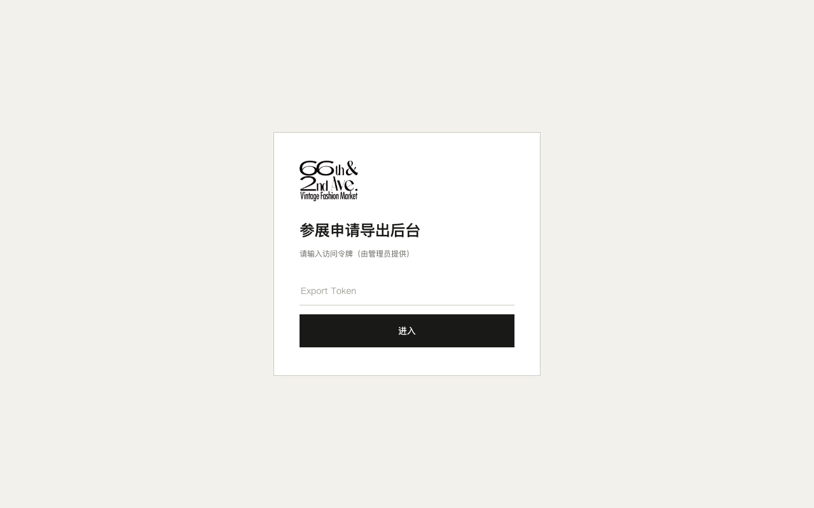
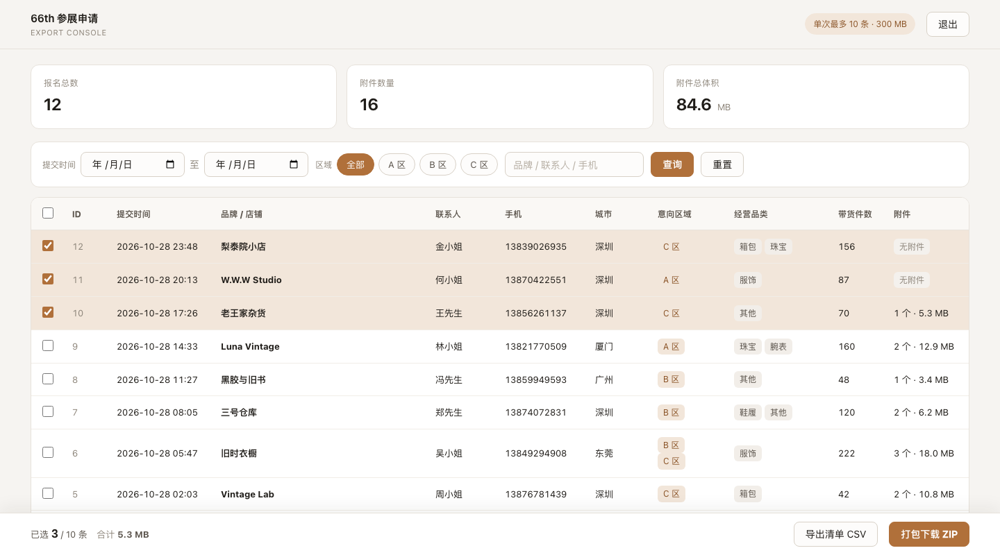
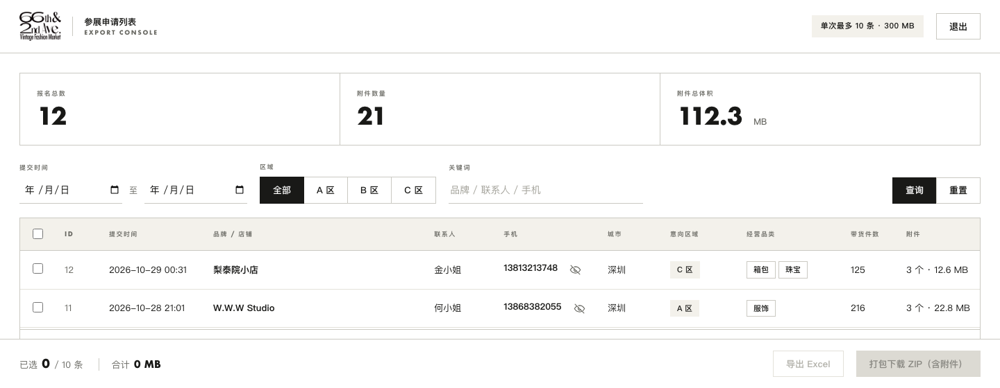
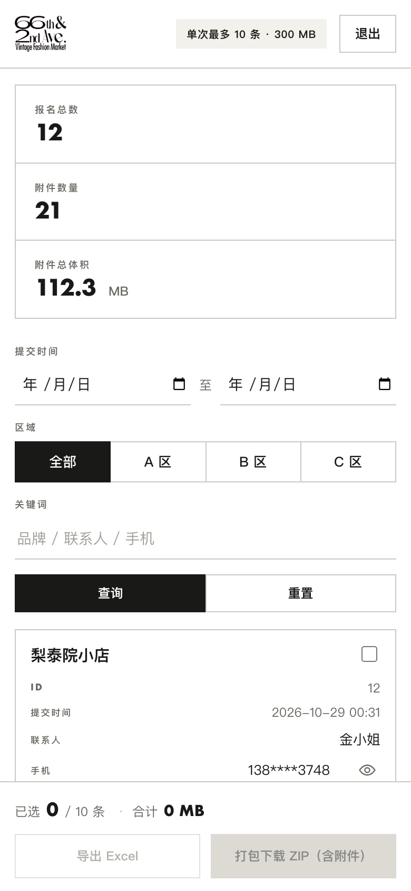
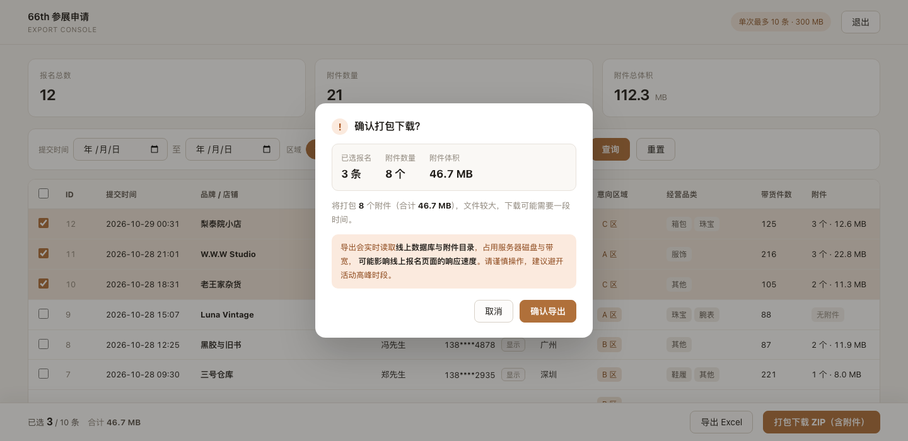

# activity-66-export

66th & 2nd 市集 —— **参展申请列表**（只读，独立服务）。

勾选 → 导出 **Excel**（三个 sheet）/ 打包下载 **ZIP**（Excel + 商家上传的原附件）。
**不写库、不动文件**，和采集服务完全隔离。

界面风格与线上报名页 [`activity-66-portal`](../../activity-66-portal) 的 `apply.html` 保持一致：
零圆角、墨黑主色、鼠尾草绿悬停、下划线输入框、大写加宽字距的标签。

品牌资产直接从报名页搬过来，保证同一套视觉：

| 文件 | 来源 | 用途 |
|---|---|---|
| `static/brand.png` | `activity-66-portal/src/assets/optimized/brand.png` | 顶栏 / 登录页 logo |
| `static/favicon.png` | `activity-66-portal/public/favicon.png` | 浏览器标签页图标 |







---

## 0. 上线与运维

完整流程（数据库准备 → 构建推送 → 部署验收 → 日常运维 → 回滚）见
**[deploy/RUNBOOK.md](deploy/RUNBOOK.md)**。

自动化发布（GitHub Actions → 阿里云）见 **[deploy/CICD.md](deploy/CICD.md)**：

| 流水线 | 触发 | 说明 |
|---|---|---|
| `deploy-source.yml` | push main | **主流程**：源码传到服务器构建，不需要镜像仓库，失败自动回滚 |
| `ci-cd.yml` | 仅手动 | 备用：推镜像到 ACR 再部署 |

审计日志查询：`./deploy/audit.sh`（`summary` / `zip` / `xlsx` / `phone` / `aborted` / `ids 12` / `today`）。

---

## 1. 先看效果（不用数据库）

```bash
./run-demo.sh
```

脚本会自动建虚拟环境、装依赖、造 12 条假数据、启动服务。
想换端口：`PORT=8020 ./run-demo.sh`；服务器上允许外部访问：`HOST=0.0.0.0 ./run-demo.sh`。

也可以手动来：

```bash
pip install -r requirements.txt
python -m app.demo            # --port 8010 --host 127.0.0.1 可改
```

浏览器打开 **http://127.0.0.1:8010/?token=demo**

会自动造 12 条假报名 + 16 个假附件，直接能看到完整界面。想重造加 `--reset`。

---

## 2. 接到真实数据

```bash
cp .env.example .env
vim .env
```

必改三项：

```ini
DATABASE_URL=mysql://exporter:<密码>@127.0.0.1:3306/verifly_signup?charset=utf8mb4
UPLOAD_DIR=/data/uploads
EXPORT_TOKEN=<一个足够长的随机串>
```

然后：

```bash
docker compose up -d --build      # 或 docker run，见 docs/DEPLOY.md
```

打开 `https://export.你的域名.com`，输入 `EXPORT_TOKEN` 进入。

> 也支持直接把 token 拼在地址上：`https://export.域名.com/?token=xxx`，进入后会自动从地址栏抹掉。

---

## 3. 界面能做什么

| 区域 | 功能 |
|---|---|
| 顶部统计 | 报名总数 / 附件数量 / 附件总体积 |
| 筛选 | 提交时间范围、区域（A/B/C）、关键词（品牌/联系人/手机） |
| 表格 | ID、时间、品牌、联系人、**手机（接口返回即脱敏，点眼睛才调接口取完整号）**、城市、意向区域、经营品类、带货件数、**附件数与大小** |
| 勾选 | 单条勾选 / 全选本页；**达上限后其余复选框自动置灰** |
| 底部操作条 | `已选 3 / 10 条 · 合计 5.3 MB` + 「导出 Excel」「打包下载 ZIP（含附件）」 |
| 手机（≤780px） | 表格自动变成**卡片**：品牌名 + 勾选框一行，其余字段「标签 — 值」两列；筛选区竖排、按钮通栏 |
| 安全阀 | 附件合计超过 `MAX_EXPORT_MB` 时，打包按钮自动禁用 |
| 导出确认 | 点导出/打包先弹确认框：显示已选条数、附件数、体积，并提示「会读取线上库与附件目录，可能影响线上响应速度」 |

## 4. 导出产物

**Excel**（`.xlsx`，三个 sheet）

| Sheet | 内容 |
|---|---|
| 报名清单 | 一行一个商家：ID、时间、品牌、联系人、手机、微信、邮箱、城市、主体类型、是否首次、经营品类、意向区域、带货件数、价格区间、商品结构四项百分比、附件数与大小、来源 |
| 代表商品 | 一行一件代表商品：报名ID、品牌、商品及品牌、年代/系列、状态及来源、拟售价 |
| 附件清单 | 一行一个附件：报名ID、品牌、文件名、类型、大小、上传时间、**包内路径**、磁盘状态 |

表头加粗上色、冻结首行、自动筛选、隔行底色 —— 拿到就能直接用。

**ZIP**（Excel + 附件原件）

```
导出_20261029_1155/
├── 报名清单_20261029_1155.xlsx          ← 三个 sheet 的汇总表
├── 001_拾光中古/
│   └── 附件/
│       ├── 拾光中古_1.zip               ← 商家上传的原文件，一字节不改
│       ├── 拾光中古_2.zip
│       └── 拾光中古_3.zip
├── 002_旧物研究所/
│   └── 附件/
└── _缺失附件清单.txt                     ← 仅当库里有记录但磁盘缺口时才出现
```

打包是**流式**的：边读磁盘边发 HTTP，不落临时文件，内存恒定几 MB。

## 5. 配置项

| 环境变量 | 默认 | 说明 |
|---|---|---|
| `DATABASE_URL` | — | 建议用**只读账号**（只给 `SELECT`） |
| `UPLOAD_DIR` | `/data/uploads` | 挂载时加 `:ro` |
| `EXPORT_TOKEN` | — | **必填**，不填则拒绝一切导出（503） |
| `LOGIN_MAX_ATTEMPTS` | `10` | 同 IP 连续输错几次锁 5 分钟 |
| `MAX_EXPORT_RECORDS` | `10` | 单次最多勾选几条 |
| `MAX_EXPORT_MB` | `300` | 单次附件合计上限 |
| `PAGE_SIZE` | `20` | 每页条数 |
| `MAX_PAGE_SIZE` | `100` | 接口允许的最大 page_size |
| `SITE_TITLE` | `参展申请列表｜66th & 2nd Ave.` | 页面标题 |
| `ALLOWED_ORIGINS` | `*` | 跨域白名单 |

改完重启容器生效，不用重新构建。

---

## 6. 接口

除 `/healthz` 与 `/` 外都需要鉴权：`Authorization: Bearer <EXPORT_TOKEN>` 或 `?token=<EXPORT_TOKEN>`。

| 方法 | 路径 | 说明 |
|---|---|---|
| `GET` | `/healthz` | 健康检查（含 DB ping） |
| `POST` | `/api/v1/auth` | 校验 token，返回限制配置 |
| `GET` | `/api/v1/summary` | 总览统计 |
| `GET` | `/api/v1/applications` | 列表，支持 `keyword` / `zone` / `date_from` / `date_to` / `with_files` / `page`；**手机号已脱敏** |
| `GET` | `/api/v1/applications/{id}/phone` | 取完整手机号（**会写审计日志**：id / IP / UA） |
| `GET` | `/api/v1/applications.xlsx?ids=1,2` | 导出 Excel（三个 sheet） |
| `GET` | `/api/v1/bundle.zip?ids=1,2` | 打包下载（Excel + 附件原件） |

```bash
# 命令行导出（不走界面）
TOKEN=你的token
curl -H "Authorization: Bearer $TOKEN" \
  "https://export.域名.com/api/v1/applications.xlsx?ids=1,2,3" -o 报名清单.xlsx

curl -H "Authorization: Bearer $TOKEN" \
  "https://export.域名.com/api/v1/bundle.zip?ids=1,2,3" -o 打包.zip
```

---

## 7. 三种启动方式

### ① 本地预览（造数据，不用连库）

```bash
./run-demo.sh                                   # → http://127.0.0.1:8010/?token=demo
PORT=8020 ./run-demo.sh                         # 换端口
HOST=0.0.0.0 ./run-demo.sh                      # 服务器上对外预览
```

> 端口被占用时会**自动打印并结束占用进程**（先 `kill`，2 秒不退再 `kill -9`）。
> 不想让它动别的进程就加 `NO_KILL=1 ./run-demo.sh`，此时只报错退出。

### ② 本地连真实库

```bash
pip install -r requirements-dev.txt   # 含测试依赖
DATABASE_URL='mysql://exporter:密码@127.0.0.1:3306/verifly_signup?charset=utf8mb4' \
UPLOAD_DIR=/verifly/activity/uploads \
EXPORT_TOKEN=你的token \
uvicorn app.main:app --host 127.0.0.1 --port 8010
```

### ③ 服务器（Docker）

```bash
# 构建推送
./deploy/build-push.sh 1.1.0

# 启动（自动带 :ro 只读挂载、资源限额、健康检查）
./deploy/run.sh /verifly/activity-export/export.env
```

`/verifly/activity-export/export.env` 至少要有：

```ini
DATABASE_URL=mysql://exporter:<密码>@127.0.0.1:3306/verifly_signup?charset=utf8mb4
EXPORT_TOKEN=<长随机串>
```

---

## 8. 启动失败怎么查

先看容器/进程日志：

```bash
docker logs --tail 30 verifly-export      # Docker
# 或直接跑前台看报错
python -m uvicorn app.main:app --port 8010
```

| 报错 | 原因 | 处理 |
|---|---|---|
| `ModuleNotFoundError: No module named 'openpyxl'` | **镜像太旧**（1.0.0 没有 Excel 依赖） | 重新 `docker build`，用 `1.1.0` |
| `ModuleNotFoundError: No module named 'app'` | 不在项目根目录跑 | `cd` 到 `export-service/` 目录 |
| `服务未配置 EXPORT_TOKEN，已禁用导出`（503） | `.env` 没填 token | 填上 `EXPORT_TOKEN` 再重启 |
| `/healthz` 返回 503 | 数据库连不上 | 查 `DATABASE_URL`、账号权限、网络 |
| `Address already in use` | 端口被占 | 换端口：`PORT=8020` 或 `--port 8020` |
| 页面白屏 | 地址少了 token | 用 `/?token=xxx`，或先在登录框输入 |
| 打包 413 | 勾选附件合计超上限 | 减少勾选，或调大 `MAX_EXPORT_MB` |

---

## 9. 为什么它影响不到采集服务

| # | 措施 |
|---|---|
| 1 | 独立容器 / 独立域名 / 独立端口 8010 |
| 2 | 数据库账号**只有 SELECT**，物理上写不了 |
| 3 | 附件目录 `-v ...:ro` 只读挂载 |
| 4 | `--cpus=1 --memory=512m` 资源限额 |
| 5 | 不引用采集服务任何代码 |
| 6 | 单次限 10 条 / 300MB，打包流式且并发不失控 |

---

## 10. 审计日志

### 页面上看

顶栏点 **「审计日志」** → 直接列出所有操作，可按类型筛选：

| 时间 | 操作 | 来源 IP | 明细 |
|---|---|---|---|
| 2026-10-29 15:31:06 | 查看手机号 | 127.0.0.1 | 报名 #3 |
| 2026-10-29 15:31:06 | 打包完成 | 127.0.0.1 | 已发送 11.4 MB |
| 2026-10-29 15:31:06 | 打包下载 | 127.0.0.1 | 报名 1 · 1 条 · 附件 3 个 · 11.4 MB |
| 2026-10-29 15:31:06 | 导出 Excel | 127.0.0.1 | 报名 1,2 · 2 条 · 附件 5 个 |

对应接口：`GET /api/v1/audit?limit=300&event=export_zip`（需 token）。

### 命令行看

```bash
docker logs verifly-export 2>&1 | grep AUDIT
./deploy/audit.sh            # 汇总
./deploy/audit.sh aborted    # 没下完的打包
./deploy/audit.sh ids 12     # 谁动过 12 号报名
```

### 记录哪些操作

| event | 触发 | 字段 |
|---|---|---|
| `reveal_phone` | 点眼睛看完整手机号 | `application_id` |
| `export_xlsx` | 导出 Excel | `ids`、`count`、`files` |
| `export_zip` | 开始打包 | `ids`、`count`、`files`、`mb` |
| `export_zip_done` | 打包结束 | `bytes`、`mb`、`aborted` |

每条都带 `ts`（时间）、`ip`、`ua`（浏览器）。

### 存在哪

写两份：

1. **容器 stdout** —— `docker logs` 长期留存（已配 20MB × 3 份轮转）
2. **`/verifly/activity-export/audit/audit.jsonl`** —— 页面读这个，容器重建不丢

文件超过 20000 行自动只保留最新 20000 行。

> **为什么不建数据库表？** 导出服务的数据库账号是**只读**的，建表就要给它 `INSERT` 权限，
> 打破"物理上改不了数据"这条底线。审计只追加、不查询详情，日志文件完全够用。

---

## 11. 设计语言

与 `activity-66-portal/src/apply.css` 共用同一套变量：

| 变量 | 值 | 用途 |
|---|---|---|
| `--ink` | `#191917` | 主文字 / 主按钮 |
| `--paper` | `#f3f1eb` | 表头、选中行、警示块 |
| `--muted` | `#696963` | 次要文字 |
| `--line` | `#cac9c2` | 1px 分隔线 |
| `--sage-deep` | `#4d6b60` | 主按钮 hover |
| `--error` | `#a2372b` | 错误 / 警示 |
| `--display` | Futura / Avenir Next Condensed | 数字与大写小标签 |
| `--font` | OPPO Sans / PingFang SC | 正文 |

约定：**圆角 0**、输入框只用下边框、按钮实心墨黑、小标签大写 + `.18em` 字距。

## 12. 开发

```bash
# 推之前先跑这个：完全复刻 GitHub Actions（纯净检出 + Python 3.12）
./deploy/ci-local.sh            # 测试三步
./deploy/ci-local.sh --docker   # 额外验证镜像构建

# 手动跑也行
pip install -r requirements-dev.txt
pytest -q                 # 26 个用例
ruff check app tests
ruff format --check app tests
python -m app.demo        # 本地预览
```

```
app/
├── main.py     接口 + 静态页
├── db.py       只读查询（SQLite / MySQL）
├── export.py   CSV + 流式 ZIP
├── auth.py     token 鉴权与失败锁定
├── config.py   环境变量
└── demo.py     假数据 + 一键启动
static/index.html   后台页面（单文件，无构建）
```
